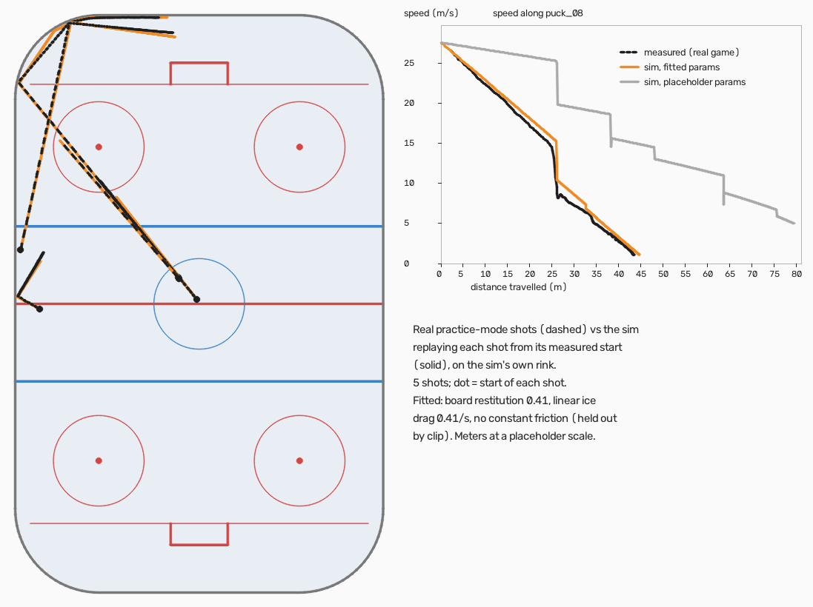

# slapmini

A compressed, top-down 2D (2.5D: the puck has height) hockey sim in Rust, modeled on Slapshot: Rebound,
for training RL bots. `params.json` holds the rink shape measured from real clips (provenance `measured-shape`), puck, player,
dash and stick params fitted to them (`fitted`), the measured player speed cap and rink length (`measured`), in real meters
(scale estimated from the in-game shot-speed readout, see CLAUDE.md). Everything else is still an unmeasured placeholder
(`params.placeholder.json` keeps the pre-fit values for tests).



*Five real practice-mode shots (dashed, measured from screen recordings by `measure/`) and the sim replaying each one from
its measured start with the fitted puck params (solid). Right: speed against distance for the corner ride, fitted vs
placeholder physics. The figure predates the absolute scale: its meters are placeholder meters (real = ×1.0873).*

Crates:

- `sim` – deterministic physics core (pure: no I/O, clock or RNG; builds for wasm32).
- `calib` – CLI + library: replay scenarios, score them against trajectory CSVs, and fit params.
- `sim-wasm` – wasm-bindgen wrapper (`new`, `step`, `get_state`, `set_state`, `set_params`, `get_params`, `reset`, `start_match`,
  `state_hash`, and the bots crate: `observe`, `action_input`, `set_scripted`, `scripted_input`). Observation check:
  `cargo run --release -p sim-wasm --example obs_fixture > target/obs_fixture.jsonl` then `node scripts/obs_crosscheck.mjs target/obs_fixture.jsonl`.
- `web/` – the browser game (`index.html`: menu, a 1v1 match against a bot, game over) and the feel lab (`lab.html`: tuning
  params live, practice drills, record/replay and ghost overlays).

**Unofficial fan project.** slapmini is not affiliated with or endorsed by the makers of Slapshot: Rebound. The game in this
repo draws everything itself (canvas shapes); it uses none of the game's art, sounds, logos or footage, and the published site
contains none. Measurement clips of the real game exist only for calibration — see "Publishing on GitHub Pages" before making
this repository public.

## Commands (same in PowerShell and macOS/Linux shells)

```sh
cargo build --release
cargo test --workspace
cargo test --workspace --release -- --nocapture       # prints fitter recovery + determinism hashes
cargo run --release -p sim --example bench            # single-thread steps/sec
wasm-pack build sim-wasm --release --target web       # -> sim-wasm/pkg

# calibration (the synthetic self-check data in calib/data/ uses the pinned calib/data/params.synthetic.json)
cargo run --release -p calib -- synth  --params calib/data/params.synthetic.json --out-dir calib/data
cargo run --release -p calib -- eval   --params calib/data/params.synthetic.json calib/data/slide_stop.scenario.json calib/data/slide_stop.csv
cargo run --release -p calib -- fit    --params calib/data/params.synthetic.json --fit ice_friction_decel,board_restitution --out fitted.json \
    [--objective path] calib/data/slide_stop.scenario.json calib/data/slide_stop.csv calib/data/wall_bounce.scenario.json calib/data/wall_bounce.csv
cargo run --release -p calib -- replay --params params.json <scenario.json> <out.csv>
# real segments (measured): baseline error of the current params
cargo run --release -p calib -- eval --params params.json calib/data/real/wall_09.scenario.json calib/data/real/wall_09.csv

# native-vs-wasm determinism cross-check
wasm-pack build sim-wasm --release --target nodejs --out-dir pkg-node
node scripts/wasm_crosscheck.mjs
cargo test -p sim --release crosscheck_hash_native -- --nocapture
```

## Game and feel lab (web/)

```sh
cd web
npm install
npx playwright install chromium   # only for the verify scripts
npm run wasm      # build sim-wasm into web/wasm-pkg
npm run dev       # http://localhost:5173 = the game menu; http://localhost:5173/lab.html = the feel lab
npm run build     # wasm + typecheck + static site in web/dist (relative paths, host as plain files from any folder)
npm run verify-game    # the game through the real UI, served from web/dist under /slapmini/ (needs npm run build first)
npm run verify    # feel-lab checks; screenshots in web/verify-out
npm run verify-match   # three full matches in match mode (mercy, clock, overtime), sped-up loop; match-*.png
npm run verify-params  # every panel parameter changed through the DOM, lab and game: effect table
npm run verify-w5b     # F2 panel in a running match, Export/Import, Space as a slow walk
npm run verify-skate   # hold W from rest: player speed vs time, ramp to the cap; skate-top-speed.png
```

Controls: WASD move; the mouse sets the stick target; Shift dash, E lift and Space slow walk (all unverified guesses). F2 in the game opens the tuning panel.
Practice tools (approximate): F spawn (hold to raise), G target, R reset puck, Q call puck to forehand.
Match mode (checkbox, or `?mode=match`): 1v1 rules from the sim (5:00 clock, mercy lead 5, sudden-death overtime),
scoreboard + OVERTIME banner + game-over overlay, Enter = rematch, practice tools off. `?speed=N` runs the loop N× real time.
Downloaded lab recordings (`.scenario.json` + `.csv`) work directly with `calib eval` / `calib fit`.

The game: menu (opponent, skill 0–100, Play vs Bot, Practice = the feel lab, Controls; arrow keys / Tab / Enter work),
then a full match as BLUE (attacking the top net) against the chosen bot, then a game-over screen (Enter = rematch,
Esc = menu). Opponents are listed in `web/public/bots/index.json`. To add a trained bot:

```sh
python -m train.export_onnx --ckpt runs/NAME/latest.pt --out web/public/bots/NAME.onnx   # also writes NAME.json
# write web/public/bots/NAME.profile.json, e.g.
#   {"name": "My bot", "description": "...", "policy": "NAME.onnx", "scripted": null,
#    "style": [0, 0, 0, 0], "skill": 100, "fallback": "chaser"}
# and add "NAME.profile.json" to the "profiles" list in web/public/bots/index.json
```

If a model is missing, corrupt or built for another observation layout, the game says so on screen and plays the
profile's scripted `fallback` instead.

Setup: Rust via rustup plus `rustup target add wasm32-unknown-unknown`, and wasm-pack (`npm install -g wasm-pack` or `cargo install wasm-pack`).

## Publishing on GitHub Pages

`.github/workflows/pages.yml` builds `web/dist` on every push to `main` and publishes it with GitHub's Pages actions.
It only checks out `main` and refuses to publish if any image or video file ends up in `dist/`.

**Read this before switching anything on.** Free GitHub Pages needs a PUBLIC repository, and this repository is
not ready to be public:

1. The `clip-data` branch holds screen recordings of the real game (`clips/*.mkv`). Move those clips to a separate
   PRIVATE repository (or local storage), then delete the `clip-data` branch here.
2. `main` itself tracks 30 images made from those recordings (game frames with the game's arena art and sponsor logos):
   `measure/results/*.map.png` (4), every file in `measure/results/qa/` except `ghost-game-view.png` (24), and
   `measure/results/skate/qa/*.path.png` (2). They are also in the git history. Before going public, either rewrite the
   history to drop them (e.g. `git filter-repo`), or publish a fresh repository made from a footage-free snapshot of `main`.
   The published site never contains them (it is built from `web/` only).

Then, as the repository owner: make the repository public (Settings → General → Danger zone → Change visibility), and
switch on Pages: Settings → Pages → Build and deployment → Source: **GitHub Actions**. The next push to `main` (or
Actions → pages → Run workflow) publishes the site at `https://<user>.github.io/<repo>/`. All paths are relative, so the
`/<repo>/` subfolder works (checked by `npm run verify-game`, which serves `dist` under `/slapmini/`).
On Windows without the Windows SDK, use the GNU toolchain: `rustup override set stable-x86_64-pc-windows-gnu` in the repo.

## Measuring real clips (measure/)

A Python tool that turns top-down screen recordings of the real game into trajectory CSVs in calib's format.
It uses OpenCV's bundled ffmpeg, so no system ffmpeg is needed. Clips live in `clips/` (gitignored; fetch them from the
`clip-data` branch with `git fetch origin clip-data`, `git checkout FETCH_HEAD -- clips/`, `git reset -q clips/`).
Outputs go to `measure/results/` (small CSV/JSON/PNG, committed). The median background frame is cached as `clips/NAME.bg.png`.

PowerShell (Windows):

```powershell
py -3 -m venv .venv
.venv\Scripts\python -m pip install -r measure\requirements.txt
.venv\Scripts\python -m measure map   clips\justpuckphysicshittingitatfixedpoint.mkv
.venv\Scripts\python -m measure track clips\justpuckphysicshittingitatfixedpoint.mkv
.venv\Scripts\python -m measure qa    clips\justpuckphysicshittingitatfixedpoint.mkv
.venv\Scripts\python -m unittest discover -s measure\tests -t .
```

bash (macOS / Linux):

```bash
python3 -m venv .venv
.venv/bin/python -m pip install -r measure/requirements.txt
.venv/bin/python -m measure map   clips/justpuckphysicshittingitatfixedpoint.mkv
.venv/bin/python -m measure track clips/justpuckphysicshittingitatfixedpoint.mkv
.venv/bin/python -m measure qa    clips/justpuckphysicshittingitatfixedpoint.mkv
.venv/bin/python -m unittest discover -s measure/tests -t .
```

Full pipeline (bash; in PowerShell use `.venv\Scripts\python` and backslashes):

```bash
C="clips/justpuckphysicshittingitatfixedpoint.mkv clips/justhittingwallphysicsfixedpoint.mkv clips/justliftedshots.mkv"
.venv/bin/python -m measure map      $C          # rink, circles (camera top-down?), lines, nets, camera check
.venv/bin/python -m measure track    $C          # puck per frame, camera motion undone
.venv/bin/python -m measure qa       $C          # QA sheets per clip
.venv/bin/python -m measure segment  $C          # free-puck stretches -> calib/data/real/*.scenario.json + .csv + manifest.json
.venv/bin/python -m measure segqa    $C --frames wall_09   # segment QA sheets (+ frame strip for a segment)
.venv/bin/python -m measure estimate             # scale-free restitution / deceleration -> calib/data/real/estimates.json
.venv/bin/python -m measure params   $C --dry-run  # measured rink shape (drop --dry-run to write params.json)
.venv/bin/python -m measure scale    $C          # board vs ice-plane scale -> map JSONs
.venv/bin/python -m measure reproject $C         # puck blob -> ground point, rewrites the traj CSVs (track does it too)
cargo build --release -p calib
.venv/bin/python -m measure holdout              # clip-held-out fits -> params.fitted.json (+ calib/data/real/holdout.json)
.venv/bin/python -m measure dragmodel            # drag-law comparison -> calib/data/real/dragmodel.json
.venv/bin/python -m measure compare puck_08 --params params.json --params params.fitted.json   # overlay -> qa/compare_puck_08.png
.venv/bin/python -m measure merge                # params.fitted.json -> params.json (the 4 fitted puck params)
.venv/bin/python -m measure sizes    $C          # puck + player radius from the frames -> params.json (measured-shape)
.venv/bin/python -m measure residuals            # per-segment residuals old vs new default vs held-out
.venv/bin/python -m measure figures              # fit figures on the sim's own rink -> measure/results/fits/
```

- `map` finds the inner board outline, center line and center dot in a median frame, fits ellipses to the center and faceoff
  circles (round = top-down camera), finds the grey lines and net roofs, writes `NAME.map.json` + `NAME.map.png`, and checks the
  camera once per second against four faceoff-dot landmarks: raw drift, and the residual after undoing it by a translation.
  It fails only if the camera motion cannot be corrected to 2 px.
- `track` undoes each frame's camera translation before detection (all positions are reference-frame pixels; frames that cannot
  be corrected are dropped). Writes `NAME.traj.csv` (`t,x,y,z`, z always 0) and `NAME.track.json` (per-row frame, pixel position,
  confidence, interpolated flag, tracklet id, blob area, camera shift; summary; `scale_source`). `--no-camera-correction` drops moved frames instead.
- `qa` writes `qa/NAME.overview.png` (whole path on the background) and `qa/NAME.sheet.png` (sampled frames with zoom insets).
- `segment` / `segqa` / `estimate` / `params`: see CLAUDE.md (segment manifest, scale-free estimates, measured rink shape).
- Several clips can be passed at once. `python -m measure synth out.mkv` renders the synthetic test video.

## File formats

- **params.json**: `{"params": {name: {"value", "provenance", "unit", "note"}}}`. Provenance is `placeholder`, `fitted`, `measured`,
  `measured-shape` or `rule`. Meters are real meters at the estimated scale (`python -m measure.rescale` applied it once).
- **Scenario** (`*.scenario.json`): `{name, description, steps, initial_state: State, inputs: [{step, player, input}]}`.
  Each input is held from its `step` until that player's next event.
- **Trajectory CSV**: header `t,x,y,z` plus an optional `stick_angle` (player 0) column. Puck position in meters, rink-centered.
  Measured tracks use t = frame / fps from the clip's first frame. Rows can be irregular: dropped frames are simply missing.

## Bots and training (bots/, sim-ffi/, train/)

- `bots` – observation vector, action format, canonical frame (each player sees itself attacking +x) and three
  scripted bots (chaser, defender, cautious, plus idle). Pure Rust, deterministic.
- `sim-ffi` – batched 1v1 environments behind a plain C ABI (`cdylib`), stepped in parallel with rayon. Reward weights are
  JSON configuration. Loaded from Python with `ctypes` (no PyO3, no maturin, no Visual Studio tools).
- `train/` – `slapenv.py` (ctypes + numpy vector env), `ppo.py` (single-file PPO with self-play), `export_onnx.py`.

Formats, reward terms and the style hooks are documented in CLAUDE.md ("Bots and training"; the current layouts are
**ACT v4** = 6 floats: move index, stick angle, dash, lift, stick_up, brake, and **OBS v3** = 42 floats: 32 base fields, the style
slot, own and opponent stick_up. Checkpoints and ONNX sidecars carry both versions; older ones (ACT v3 and before) are refused:
retrain, then re-export. metrics.csv logs `stick_up_prob`, `stick_up_frac`, `brake_prob`, `brake_frac`.

### Rust side (same in PowerShell and bash)

```sh
cargo build --release -p sim-ffi                          # -> target/release/sim_ffi.dll (Windows) / libsim_ffi.so / libsim_ffi.dylib
cargo test --workspace                                    # includes the bots and sim-ffi tests
cargo run --release -p sim-ffi --example bench            # env throughput (1/8/64 envs) + determinism check
cargo run --release -p bots --example tournament 40 60    # scripted bots round robin: 40 matches x 60 s per pairing
cargo run --release -p bots --example shotlab             # scripted shot accuracy (re-measure after physics changes)
```

### Python setup: check the GPU, install the matching PyTorch

Training runs on CPU or an NVIDIA GPU; the device is picked automatically (CUDA if PyTorch sees one).

1. Check the GPU and the driver's CUDA version: `nvidia-smi` (the top right says e.g. `CUDA Version: 12.8`; that is the newest
   CUDA runtime the driver supports). No `nvidia-smi` / no NVIDIA GPU: use the CPU build.
2. Pick the PyTorch command for that CUDA version (or CPU) at https://pytorch.org/get-started/locally/ (Stable, your OS, Pip,
   Python, CUDA x.y) and run it with the venv's python. Any CUDA build not newer than the driver's version works.
3. Install the rest and confirm PyTorch sees the GPU.

PowerShell (Windows):

```powershell
py -3 -m venv .venv
nvidia-smi
.venv\Scripts\python -m pip install torch --index-url https://download.pytorch.org/whl/cu128   # use the line pytorch.org gives you; .../whl/cpu for CPU only
.venv\Scripts\python -m pip install -r train\requirements.txt
.venv\Scripts\python -c "import torch; print(torch.__version__, torch.cuda.is_available(), torch.cuda.get_device_name(0) if torch.cuda.is_available() else 'cpu')"
cargo build --release -p sim-ffi
.venv\Scripts\python -m unittest discover -s train\tests -t .
```

bash (Linux / macOS):

```bash
python3 -m venv .venv
nvidia-smi
.venv/bin/python -m pip install torch --index-url https://download.pytorch.org/whl/cu128     # or the line pytorch.org gives you; .../whl/cpu for CPU only
.venv/bin/python -m pip install -r train/requirements.txt
.venv/bin/python -c "import torch; print(torch.__version__, torch.cuda.is_available())"
cargo build --release -p sim-ffi
.venv/bin/python -m unittest discover -s train/tests -t .
```

### Train, evaluate, export

PowerShell (replace `.venv\Scripts\python` with `.venv/bin/python` and `\` with `/` in bash):

```powershell
# train against the chaser for 30 minutes on first-goal episodes (runs/NAME holds latest.pt, metrics.csv, learning_curve.png)
.venv\Scripts\python -m train.ppo train --run runs\chaser --minutes 30 --opponents chaser --plot
# full matches (5:00 clock, mercy at a 5-goal lead, next-goal overtime), after 20 minutes of first-goal curriculum
.venv\Scripts\python -m train.ppo train --run runs\match --minutes 120 --curriculum-minutes 20 --opponents chaser --plot
# self-play: frozen snapshots from a pool (one added every 50 updates) mixed with the scripted bots
.venv\Scripts\python -m train.ppo train --run runs\selfplay --minutes 120 --opponents "chaser:0.2,defender:0.1,cautious:0.1,pool:0.6" --plot
# resume (refuses if params.json's physics changed since the checkpoint; --allow-physics-change overrides)
.venv\Scripts\python -m train.ppo train --run runs\selfplay --minutes 240 --opponents "chaser:0.2,defender:0.1,cautious:0.1,pool:0.6" --resume runs\selfplay\latest.pt
# evaluate on full matches against a scripted bot (or a checkpoint path as --opponent); baselines: --policy random / untrained
.venv\Scripts\python -m train.ppo eval --ckpt runs\chaser\latest.pt --opponent chaser --episodes 64
.venv\Scripts\python -m train.ppo eval --policy random --opponent chaser --episodes 64
.venv\Scripts\python -m train.ppo plot --run runs\chaser
# rating ladder: checkpoints vs the scripted bots and each other, Elo ratings + per-style statistics -> JSON
.venv\Scripts\python -m train.league --ckpts "runs\match\ckpts\*.pt" runs\match\latest.pt --matches 16 --out runs\match\league.json
# export for the browser (deterministic policy; checks onnxruntime against PyTorch)
.venv\Scripts\python -m train.export_onnx --ckpt runs\chaser\latest.pt --out web\public\bots\chaser.onnx
```

`runs/` is gitignored. Useful knobs: `--envs` (default 64), `--mode first_goal|match`, `--curriculum-minutes M`, `--styles`
(sample a play style per episode), `--obs-norm` (running observation normalization), `--keep-every N` (keep
`ckpts/upd_N.pt` for the ladder), `--threads` / `--torch-threads` (auto by default), `--device` (update device,
`auto`/`cpu`/`cuda`), `--rollout-device` (acting device, default `cpu`), `--reward weights.json`, `--profile`
(time breakdown table at the end, also written to `runs/NAME/profile.md`).

### Adopting tuned values
Export from the panel (F2 in the game, or the lab), then `npm run adopt-params -- path/to/params.json` in `web/` (`--dry-run` to preview). Changed rows get provenance `tuned-by-feel`; unknown names or out-of-range values write nothing. The physics stamp changes, so resuming a run needs `--allow-physics-change`.

### Long run on Ian's machine (RTX 3070 Ti, 12-core CPU)

Measured on that machine (decisions per second of training, update on the GPU, rollouts on the CPU): 64 envs 43k,
128 envs 72k, 256 envs 110–117k, **512 envs 157–176k**. More envs mostly share fixed per-step Python costs, so they are
nearly free; the price is a larger batch per update (envs × steps samples). The command below uses 512 envs and splits
each update into 8 minibatches (65,536 samples per update, 8,192 per minibatch) instead of the default 4.

Start (PowerShell, from the repo root; 8 hours of training; `--minutes` counts the total across resumes):

```powershell
cargo build --release -p sim-ffi
.venv\Scripts\python -m train.ppo train --run runs\long1 --minutes 480 --envs 512 --minibatches 8 `
  --curriculum-minutes 60 --opponents "chaser:0.3,defender:0.15,cautious:0.05,pool:0.5" `
  --styles --obs-norm --keep-every 200 --anneal --print-every 20 --plot
```

What it does: 60 minutes of first-goal episodes (dense rewards), then full matches; every episode samples a style
(aggression, shot-taking, possession, defense) that shifts the shaping reward and is shown to the policy; half the
opponents are frozen snapshots of itself; rayon uses 8 env threads and torch 4 CPU threads (auto for 512 envs).

Monitor (a second PowerShell window):

```powershell
Get-Content runs\long1\metrics.csv -Tail 3 -Wait                    # one row per update
.venv\Scripts\python -m train.ppo plot --run runs\long1              # refresh runs\long1\learning_curve.png any time
nvidia-smi -l 10                                                     # GPU use (low is normal: the GPU only runs the update)
```

Stop: press Ctrl+C once; it finishes the current update, writes `runs\long1\latest.pt` and exits (a second Ctrl+C aborts
without saving; `latest.pt` is also written every 25 updates). Resume with the same command plus
`--resume runs\long1\latest.pt` (and a larger `--minutes` if the budget was used up). It refuses to resume if params.json
changed since the checkpoint (physics stamp); `--allow-physics-change` continues anyway.

Evaluate and rate, then export:

```powershell
.venv\Scripts\python -m train.ppo eval --ckpt runs\long1\latest.pt --opponent chaser --episodes 64 --envs 32
.venv\Scripts\python -m train.ppo eval --ckpt runs\long1\latest.pt --opponent defender --episodes 64 --envs 32
.venv\Scripts\python -m train.league --ckpts "runs\long1\ckpts\*.pt" runs\long1\latest.pt --matches 16 `
  --styles "0,0,0,0;1,0,0,0;0,1,0,0;0,0,1,0;0,0,0,1;-1,-1,0,1" --out runs\long1\league.json
.venv\Scripts\python -m train.export_onnx --ckpt runs\long1\latest.pt --out web\public\bots\long1.onnx
```

Is it working? In the console and `metrics.csv` (rolling over the last 400 episodes):
- `win` against the mix rises and `goal_diff` per episode climbs above 0 within the first hour (first-goal phase); after
  the switch to matches (purple line in the plot) the numbers reset and should climb again, more slowly.
- `ep_seconds` in match mode: early matches end by mercy or the clock; `truncated` (overtime cap) should stay rare.
- `entropy` falls slowly (starts near 6.1 = log 9 + the stick Gaussian + three coin flips: dash, lift, stick_up); a crash toward 0 in minutes means collapse. `kl` stays below ~0.03.
- `dec/s` stays flat (a drop means something else is using the CPU).
- `stick_up_prob` / `stick_up_frac` (console `up p … raised …`): mean P(stick up) and the share of decisions with the
  stick raised. It starts at 0.5 (a fresh coin flip). If it climbs toward 1 the policy is keeping the stick up most of
  the time (a raised stick never touches a puck on the ice, so it avoids accidental own contacts); check that before
  adding any reward term.
- The ladder's ratings for the kept checkpoints rise with the update number and pass the chaser (1000); per-style rows
  differ (shots per match higher for style 0,1,0,0; possession share higher for 0,0,1,0).
Signs of trouble: win rate stuck at 0 after an hour in first-goal mode, entropy collapse, NaN losses, or ratings that fall
as training goes on (self-play cycling: lower `pool`, raise the scripted share).

## Skating clips, key display and scale (session s7)

```sh
# (clips from the clip-data branch, see "Measuring real clips")
.venv/bin/python -m measure.skate templates                               # keycap glyph templates (measure/key_templates.json)
.venv/bin/python -m measure.skate track clips/wkeymovement.mkv clips/diagonalkeypresses.mkv clips/whilemovingturning.mkv clips/dashatrest.mkv clips/dashwhilerunning.mkv
.venv/bin/python -m measure.skate qa diagonalkeypresses                   # registered player path over frames
cargo build --release -p calib
.venv/bin/python -m measure.skatefit scenarios                            # runs + key->motion lag -> calib/data/skate/
.venv/bin/python -m measure.skatefit fit                                  # held-out player/dash fits -> results/skate/fits.json
.venv/bin/python -m measure.skatefit params                               # -> params.player.json (provenance fitted)
.venv/bin/python -m measure.skatefit plot                                 # measured vs sim speed curves
.venv/bin/python -m measure.goalscale track                               # goalspeeds_part00..03 (one recording)
.venv/bin/python -m measure.goalscale scale                               # -> measure/results/scale.json
```
(PowerShell: `.venv\Scripts\python` and backslashes.) A calib scenario with `"track": "player0"` compares player 0's path instead
of the puck: `cargo run --release -p calib -- eval --params params.json calib/data/skate/wkeymovement_00.scenario.json calib/data/skate/wkeymovement_00.csv`.
